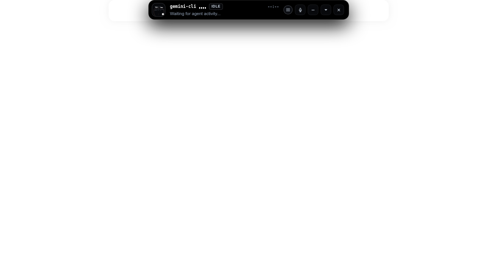
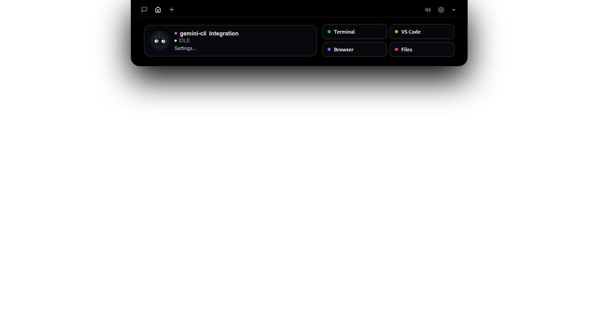
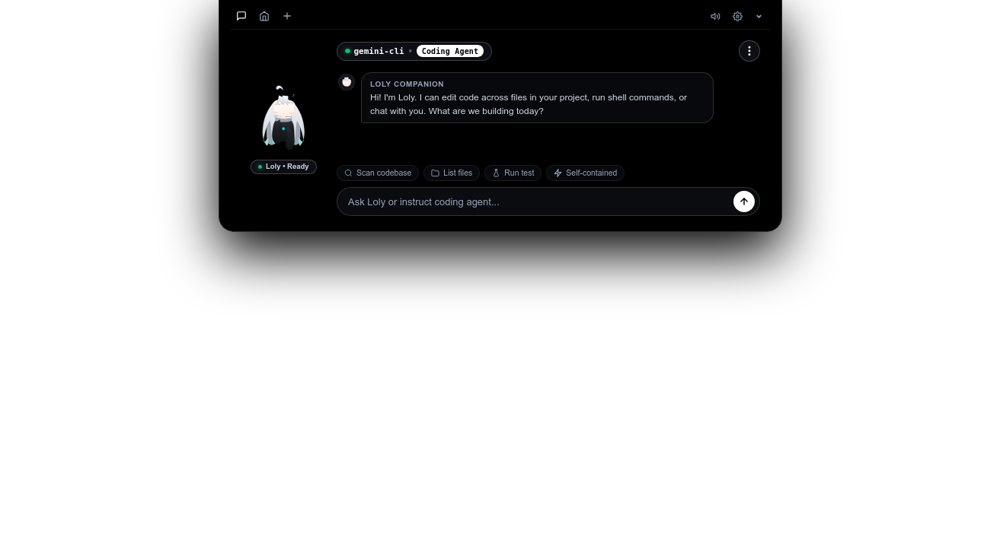
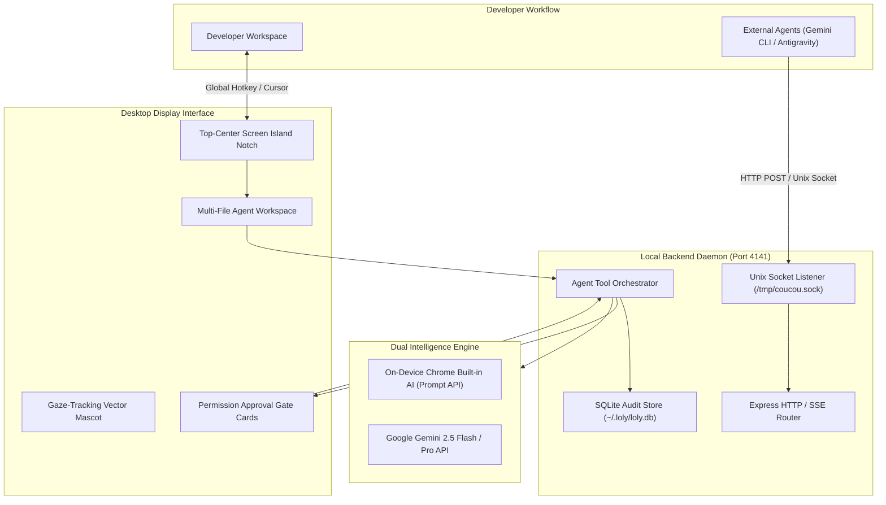

<div align="center">


# Loly Companion

### Autonomous AI Coding Agent Companion & Desktop Screen Island

An intelligent, non-intrusive desktop companion and floating notch interface designed for developers orchestrating autonomous AI coding agents. Engineered with Google Gemini, on-device Chrome Built-in AI, Anthropic Claude, Openai, real-time terminal approval gates, and multi-file code editing capabilities.

<br/>

[](https://github.com/PAIN-hub/Loly_Companion/releases)
[](https://pain-hub.github.io/Loly_Companion/)
[](https://github.com/PAIN-hub/Loly_Companion/releases)
[](GEMINI_API_GUIDE.md)
[](LICENSE)

<br/>

<p align="center">
  <a href="https://pain-hub.github.io/Loly_Companion/" style="text-decoration: none;"><code>Documentation &amp; Demo</code></a> &nbsp;&bull;&nbsp;
  <a href="#downloads--packages" style="text-decoration: none;"><code>Download Binaries</code></a> &nbsp;&bull;&nbsp;
  <a href="GEMINI_API_GUIDE.md" style="text-decoration: none;"><code>Gemini Setup Guide</code></a> &nbsp;&bull;&nbsp;
  <a href="#quickstart" style="text-decoration: none;"><code>Quickstart</code></a> &nbsp;&bull;&nbsp;
  <a href="#architecture" style="text-decoration: none;"><code>Architecture</code></a>
</p>

---

## Visual Overview

##### Floating Hardware Notch
 

#####  Real-Time Agent Tool Inspection


##### Chat agent preview


</div>

---

## Executive Summary

When autonomous agentic systems (such as Gemini CLI, Claude Code, Antigravity, and Cursor) perform complex multi-turn modifications across codebases, developers lose visibility into background edits, command invocations, and pending execution gates.

**Loly Companion** establishes continuous real-time oversight via an unobtrusive screen island anchored to the top center of your display:

- **Autonomous Multi-File Coding Agent (Gen-v5 Engine)**: Direct Loly to inspect, create, refactor, and execute terminal commands across local directories within verified security boundaries.
- **In-Pill Permission Approvals**: Grant or deny terminal executions (`Allow`, `Deny`, `Always`) directly from the floating interface without switching application focus.
- **Multi-Provider AI Architecture**: Built-in default support for **Google Gemini 3.5 Flash** with seamless switching across **Anthropic Claude 3.7 Sonnet**, **OpenAI GPT-4o**, and on-device **Chrome Built-in AI** (Gemini Nano).
- **Sound-Reactive RGB Lo-Fi Music Workstation**: Procedural ambient focus synthesizer and local audio library player powered by Web Audio API `AnalyserNode`, featuring real-time audio-frequency reactive dynamic RGB border pulses on the companion island and floating player.
- **Zero-Delay Custom Tooltips (`lolyCustomTooltip`)**: Native OS tooltips replaced by a customized, interactive indicator providing live playback status and quick action hints.
- **Interactive Folder Selector & Chat History**: One-click local directory switcher and persistent multi-turn chat sessions with instant rename and delete options.
- **Complete Data Sovereignty**: All audit logs, file diffs, and chat sessions are stored locally in an isolated SQLite database (`~/.loly/loly.db`). Zero telemetry or external tracking.

---

## Downloads & Packages

Standalone compiled binaries are available for Windows, Linux, and macOS. Every release includes an embedded Node.js backend daemon and operates out of the box with no manual server management.

### Windows (x64)

| Distribution | Asset | Architecture | Package Details |
|---|---|---|---|
| Portable Executable | [`Loly-2.1.0.exe`](https://github.com/PAIN-hub/Loly_Companion/releases/download/v2.1.0/Loly-2.1.0.exe) | `x86_64` | Standalone binary. Runs directly without installation. |
| Setup Installer | [`Loly-Setup-2.1.0.exe`](https://github.com/PAIN-hub/Loly_Companion/releases/download/v2.1.0/Loly-Setup-2.1.0.exe) | `x86_64` | NSIS wizard with Start Menu and desktop shortcut creation. |

### Linux (x64)

| Distribution | Asset | Architecture | Package Details |
|---|---|---|---|
| Universal AppImage | [`Loly-2.1.0.AppImage`](https://github.com/PAIN-hub/Loly_Companion/releases/download/v2.1.0/Loly-2.1.0.AppImage) | `x86_64` | Compatible with Ubuntu, Debian, Arch, Fedora, and Kali Linux. |
| Debian Package | [`loly_2.1.0_amd64.deb`](https://github.com/PAIN-hub/Loly_Companion/releases/download/v2.1.0/loly_2.1.0_amd64.deb) | `amd64` | Native distribution package installer via `sudo dpkg -i`. |

### macOS (Apple Silicon & Intel)

| Distribution | Asset | Architecture | Package Details |
|---|---|---|---|
| Application Bundle | [`Loly-2.1.0-arm64-mac.zip`](https://github.com/PAIN-hub/Loly_Companion/releases/download/v2.1.0/Loly-2.1.0-arm64-mac.zip) | `arm64 / Universal` | Standalone `.app` archive. Unzip and drag to `/Applications`. |

---

## Architecture



---

## Core Capabilities

### 1. Hardware Screen Notch & Floating Drawer
- **Anchored Geometry**: Positioned flush against the upper display boundary with an ergonomic 530px hardware cutout and fluid spring expansion animation.
- **Dynamic Gaze Mascot**: Mathematical coordinate calculation dynamically orients the anime mascot's pupil vector toward current cursor positions.
- **Three-Dot Menu Navigation**: Consolidates agent mode selectors, model configurations, and workspace directories into a compact, clean interface.

### 2. Autonomous Agent Execution Engine
- **Filesystem Tools**: Exposes granular tools (`read_file`, `write_file`, `list_directory`, `run_command`, `git_status`) directly to Gemini models.
- **Workspace Sandboxing**: Restricts file modifications strictly within validated repository roots to protect against directory traversal attacks.
- **Streaming Response**: Real-time server-sent events (SSE) stream tool progress, execution outputs, and file diffs as they materialize.

### 3. Integrated Security & Terminal Approvals
- **IPC & HTTP Hooks**: External agents stream status events and approval requests via local Unix socket (`/tmp/coucou.sock`) or HTTP POST (`/api/hook`).
- **Interactive Decision Cards**: One-click approval cards grant developers decisive governance over terminal command execution.

### 4. Audio Engine & Local Storage
- **Procedural Ambient Synthesizer**: Web Audio API chords tailored for deep concentration (*Midnight Lo-Fi*, *Cyber Synthwave*, *Chill Coffee*, *Rain Focus*).
- **IndexedDB Workstation**: Import personal audio files locally without third-party streaming dependencies or cloud infrastructure.

---

## Quickstart

### Prerequisites
- Node.js 20.0.0 or higher
- npm 9.0.0 or higher

### 1. Clone & Install
```bash
git clone https://github.com/PAIN-hub/Loly_Companion.git
cd Loly_Companion
npm install
```

### 2. Desktop Mode (Electron)
```bash
npm run electron
```
- Hotkey: Press `Ctrl + Shift + L` (Windows/Linux) or `Cmd + Shift + L` (macOS) to toggle island visibility at any time.

### 3. Web Mode
```bash
npm start
```
Navigate to [`http://127.0.0.1:4141`](http://127.0.0.1:4141) in your browser.

---

## API Configuration

To enable Gemini capabilities, configure your API credentials through either of the following methods:

1. **In-App Interface**: Access Settings via the menu gear icon, input your API key, and select **Save Settings**.
2. **Environment Variable**:
   ```bash
   export GEMINI_API_KEY="your-gemini-api-key"
   npm start
   ```

Refer to the [`Gemini Setup Guide`](GEMINI_API_GUIDE.md) for detailed configuration options.

---

## Agent Integration Hook

External agents and scripts can dispatch real-time events to Loly Companion via HTTP or Unix domain socket:

```bash
curl -X POST http://127.0.0.1:4141/api/hook \
  -H "Content-Type: application/json" \
  -d '{
    "coucou_agent": "gemini-cli",
    "event_type": "approval_request",
    "title": "Bash Command Approval Required",
    "target": "npm test -- --coverage",
    "requires_approval": true
  }'
```

---

## Security & Data Privacy

- **Local Storage**: Configuration parameters, audit logs, and session records are maintained exclusively in local SQLite storage (`~/.loly/loly.db`).
- **Zero Cloud Telemetry**: No usage metrics, telemetry packets, or diagnostic analytics are transmitted.
- **Isolated Credentials**: API keys remain securely inside local configuration and are never transmitted to unauthorized endpoints or committed to version control.

---

## License

This software is licensed under the [`MIT License`](LICENSE).
