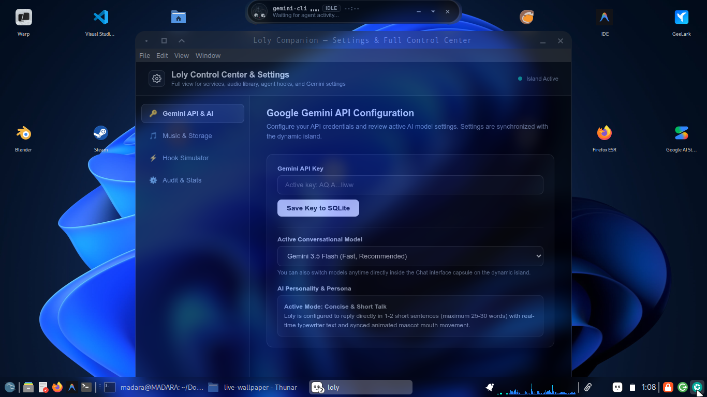
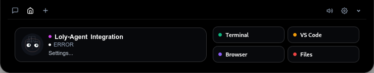
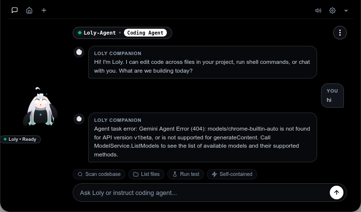

# 🌟 Loly Companion — AI Coding Agent Desktop Screen Island

<div align="center">



### An intelligent screen island & desktop companion for Windows & Linux
*Watching over autonomous AI coding agents with the Google Gemini API, interactive cursor-tracking mascot, one-click terminal approvals, and procedural focus lo-fi beats.*

[](https://github.com/PAIN-hub/Loly_Companion/releases)
[](https://pain-hub.github.io/Loly_Companion/)
[](LICENSE)
[](https://github.com/PAIN-hub/Loly_Companion/releases)
[](GEMINI_API_GUIDE.md)
[](package.json)

**[🌐 Official Website & Live Web Simulator](https://pain-hub.github.io/Loly_Companion/)** • **[📦 Download Releases](#-downloads--releases)** • **[🔑 Gemini API Guide](GEMINI_API_GUIDE.md)** • **[📖 Quickstart](#-how-to-run-locally)**

<br/>

<div align="center">

### 🖥️ Hardware Notch & Autonomous Coding Agent UI (v2.0.0)

| Collapsed Screen Notch | Expanded Agent Tools |
| :---: | :---: |
|  |  |

<br/>



</div>

</div>

---

## 📖 Table of Contents
1. [Overview](#-overview)
2. [📦 Downloads & Releases (Windows & Linux)](#-downloads--releases)
3. [✨ Key Features](#-key-features)
4. [🚀 How to Run Locally (Node.js & Electron)](#-how-to-run-locally)
5. [🔑 Google Gemini API Setup](#-google-gemini-api-setup)
6. [🔌 Connecting AI Agents (Hooks & Sockets)](#-connecting-ai-agents)
7. [🎨 Dual Theme Architecture (White Mode & Pitch-Black OLED)](#-dual-theme-architecture)
8. [🔒 Privacy & Security Standards](#-privacy--security-standards)
9. [🛠️ Contributing & Development](#-contributing--development)
10. [📄 License](#-license)

---

## 🌟 Overview

As autonomous coding agents (**Gemini CLI**, **Claude Code**, **Antigravity**, **Cursor**, **Codex**) run long multi-file refactorings and terminal commands in background terminals, developers lose visibility into what files are being touched and what commands require approval.

**Loly Companion** solves this with a lightweight screen island (anchored seamlessly at the top center of your monitor) and an interactive companion mascot (**Loly**):
- **Live Stream Ticker**: Real-time ticker of active commands, tools, and git diff statistics (`+42 -10`).
- **Interactive Cursor-Tracking Mascot**: Calculates geometric vectors in real-time to follow your mouse gaze across the screen.
- **In-Pill Permission Approvals**: Approve or deny sensitive bash commands (`Allow`, `Deny`, `Always`) directly from the island without switching terminal focus.
- **AI Safety Review**: One-click prompt that asks **Gemini 2.5 Flash** to inspect pending commands or diffs for destructive risk.
- **Procedural Lo-Fi Soundscapes**: Lightweight focus music synthesizer built directly into the Web Audio API with zero external MP3 dependencies.
- **Private SQLite Storage**: Zero telemetry. All audit trails, chat logs, and approval histories stay in your local `~/.loly/loly.db`.

---

## 📦 Downloads & Releases (v2.0.0)

Loly Companion v2 provides standalone production binaries for **Windows**, **Linux**, and **macOS**. You can download them directly from the [GitHub Releases page](https://github.com/PAIN-hub/Loly_Companion/releases/tag/v2.0.0) or use the links below:

### 🪟 Windows (64-bit)

| Package | File Name | Size | Description |
|---|---|---|---|
| **Portable (.exe)** | [`Loly-2.0.0.exe`](https://github.com/PAIN-hub/Loly_Companion/releases/download/v2.0.0/Loly-2.0.0.exe) | ~95 MB | **Zero Installation**: Double-click to run immediately on any Windows 10/11 system. |
| **Setup Installer (.exe)** | [`Loly-Setup-2.0.0.exe`](https://github.com/PAIN-hub/Loly_Companion/releases/download/v2.0.0/Loly-Setup-2.0.0.exe) | ~95 MB | Full desktop NSIS installer with desktop shortcut and Start Menu entry. |
| **Zipped Archive (.zip)** | [`loly-windows-package.zip`](https://github.com/PAIN-hub/Loly_Companion/releases/download/v2.0.0/loly-windows-package.zip) | ~25 MB | Zipped package with all runtime dependencies. |

> **How to run on Windows**:
> 1. Download `Loly-2.0.0.exe`.
> 2. Double-click to launch.
> 3. Loly appears as a floating transparent island at the top of your screen. Toggle visibility anytime with `Ctrl + Shift + L`.

---

### 🐧 Linux (x86_64)

| Package | File Name | Size | Description |
|---|---|---|---|
| **Universal AppImage** | [`Loly-2.0.0.AppImage`](https://github.com/PAIN-hub/Loly_Companion/releases/download/v2.0.0/Loly-2.0.0.AppImage) | ~120 MB | **Works on all distros**: Ubuntu 22.04/24.04+, Debian, Kali, Fedora, Arch, with or without `libfuse2`. |
| **Debian / Ubuntu (.deb)** | [`loly_2.0.0_amd64.deb`](https://github.com/PAIN-hub/Loly_Companion/releases/download/v2.0.0/loly_2.0.0_amd64.deb) | ~95 MB | Native Debian package. Integrates into your application menu. |
| **Portable Tarball** | [`loly-linux-x64.tar.gz`](https://github.com/PAIN-hub/Loly_Companion/releases/download/v2.0.0/loly-linux-x64.tar.gz) | ~117 MB | Standalone portable archive. Extract and run `./loly`. |

> **How to run on Linux**:
> ```bash
> # Make the AppImage executable and launch:
> chmod +x Loly-2.0.0.AppImage
> ./Loly-2.0.0.AppImage
> 
> # Or install via dpkg on Debian/Ubuntu/Kali:
> sudo dpkg -i loly_2.0.0_amd64.deb
> ```

---

### 🍎 macOS (Apple Silicon & Intel)

| Package | File Name | Size | Description |
|---|---|---|---|
| **macOS Bundle (.zip)** | [`Loly-2.0.0-arm64-mac.zip`](https://github.com/PAIN-hub/Loly_Companion/releases/download/v2.0.0/Loly-2.0.0-arm64-mac.zip) | ~127 MB | Standalone macOS application bundle. Unzip and drag `Loly.app` into Applications. |

---

## ✨ Key Features

1. **Top Screen Dynamic Island & Floating Mascot**:
   - Anchored at top center or viewable as a floating desktop app.
   - Animated SVG mascot whose pupils follow your cursor across the screen.
   - Automatic mood transitions: `idle` breathing, `working` HUD coding, `alert` permission attention, `happy` celebration bounce.

2. **In-Pill Permission Approvals & Questions**:
   - `[ Allow ]`, `[ Deny ]`, `[ Always ]` buttons embedded right in the island pill.
   - Instant response sent back to the waiting agent terminal via HTTP or Unix domain socket.

3. **Direct Google Gemini Assistant**:
   - Instant streaming typewriter chat powered by **Gemini 2.5 Flash**.
   - Synchronized mascot mouth flapping during speech synthesis.
   - In-chat dynamic model selector (`gemini-2.5-flash`, `gemini-1.5-flash`, `gemini-1.5-pro`, `gemini-2.0-flash-exp`).
   - Drag-and-drop file inspection for PDFs, code, docs, and images.

4. **Procedural Lo-Fi Focus Music Player**:
   - 4 ambient soundscapes: `Midnight Lo-Fi`, `Cyber Synthwave`, `Chill Coffee Beats`, `Rain Ambient Focus`.
   - Synthesized natively via the **Web Audio API** (zero external MP3 downloads; zero latency).
   - Animated spinning vinyl disc and volume controls.

5. **Live Digital Clock & Weather Widget**:
   - Real-time digital clock in the header.
   - Live temperature and weather condition fetched via `/api/weather` with custom city customization in Settings.

6. **Quick App Launcher**:
   - One-click launch chips for **Terminal**, **VS Code**, **Web Browser**, and **File Manager**.

7. **Local SQLite Audit Storage**:
   - Built on native `node:sqlite`. Zero external C dependencies.
   - Logs sessions, events, approvals, and chat logs locally in `~/.loly/loly.db` (Linux) or `%USERPROFILE%\.loly\loly.db` (Windows).

---

## 🚀 How to Run Locally

You can run Loly Companion directly from source using Node.js:

### Prerequisites
- **Node.js** (v20+ or v22+ recommended)
- **npm** (included with Node.js)
- Modern web browser (Chrome, Edge, Firefox, Brave)

### 1. Clone the Repository
```bash
git clone https://github.com/PAIN-hub/Loly_Companion.git
cd Loly_Companion
```

### 2. Install Dependencies
```bash
npm install
```

### 3. Launch Option A: Web Browser Mode
```bash
npm start
```
Open **`http://127.0.0.1:4141`** in your browser.

### 4. Launch Option B: Native Desktop Dynamic Island (Electron)
```bash
npm run electron
```
This automatically boots the background daemon and displays the transparent, always-on-top hardware notch at the top center of your screen.
- Toggle Island hotkey: `Ctrl + Shift + L` (Windows/Linux) or `Cmd + Shift + L` (macOS).

---

## 🔑 Google Gemini API Setup

Loly connects to the **Google Gemini API** to power chat responses and automated command safety reviews.

> 📘 **Detailed Guide**: Please read the complete step-by-step walkthrough in [**`GEMINI_API_GUIDE.md`**](GEMINI_API_GUIDE.md).

### Quick Setup:
1. Visit [Google AI Studio](https://aistudio.google.com/app/apikey) and create a free API key (1,500 requests/day free tier).
2. Open Loly, click the **Gear icon (⚙)** to open **Settings**.
3. Paste your key in the **Gemini API Key** field and click **Save Settings**.
4. Alternatively, export your key in your terminal before running:
   ```bash
   export GEMINI_API_KEY="AIzaSyYourSecretKey"
   npm start
   ```

---

## 🔌 Connecting AI Agents

Loly provides a universal hook bus that any agent, script, or CI pipeline can send events to:

### 1. HTTP POST (Any Platform)
```bash
curl -X POST http://127.0.0.1:4141/api/hook \
  -H "Content-Type: application/json" \
  -d '{
    "coucou_agent": "gemini-cli",
    "event_type": "approval_request",
    "title": "Bash Command Approval",
    "target": "npm run build",
    "requires_approval": true
  }'
```

### 2. Unix Domain Socket (Linux / macOS)
```bash
echo '{"coucou_agent":"antigravity","action":"git commit -m \"feat: done\""}' | socat - UNIX-CONNECT:/tmp/coucou.sock
```

### 3. Built-in Test Simulator
Test real-time event ingestion by running:
```bash
npm run simulate
```

---

## 🎨 Dual Theme Architecture

Loly Companion features two carefully tuned themes:
- **Clean White Mode**: Elegant ceramic white island pill, slate-900 typography, light neutral borders, and high contrast.
- **Pitch-Black OLED Mode**: Deepest pure pitch-black (`#000000`) with glass rim reflection matching hardware notches.

Switch between themes with 1 click directly in the island header or in Settings.

---

## 🔒 Privacy & Security Standards

- **100% Local & Private**: No analytics, telemetry, or user data are ever sent to remote tracking servers.
- **Local SQLite DB**: Session data and event audits are stored strictly on your local disk (`~/.loly/loly.db`).
- **Secret Protection**: `.gitignore` strictly protects `.env`, `credentials.json`, `loly.db`, and all private tokens from accidental commits.
- **Safe Approvals**: Destructive terminal actions require manual user confirmation before the waiting terminal proceeds.

---

## 🛠️ Contributing & Development

Contributions, bug reports, and suggestions are welcome!

1. Fork the repository on GitHub.
2. Create a feature branch: `git checkout -b feature/awesome-feature`.
3. Commit your changes: `git commit -m "feat: add awesome feature"`.
4. Push to your branch: `git push origin feature/awesome-feature`.
5. Open a Pull Request.

---

## 📄 License

This project is licensed under the [MIT License](LICENSE).

---

<div align="center">
  <sub>Built with ❤️ by <a href="https://github.com/PAIN-hub">PAIN-hub</a> • Inspired by Coucou & modern screen notch companions.</sub>
</div>
